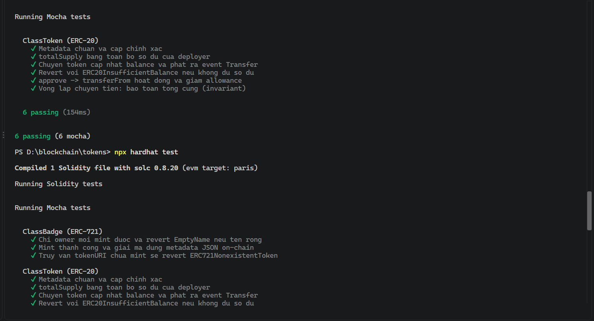
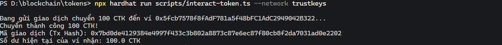

# Báo cáo thực hành Lab 07 – Token Standards on Hardhat + TrustKeys

- **Họ và tên:** Nguyễn Hữu Luân
- **Mạng thực hành:** TrustKeys L1 Testnet (Chain ID: 11968)

---

### 1. Kết quả kiểm thử Unit Tests
- Trạng thái: All tests green (`ClassToken` + `ClassBadge`).


---

### 2. Thông tin triển khai On-chain
- **ClassToken (ERC-20):** `0x_dia_chi_ClassToken_vua_deploy`
- **ClassBadge (ERC-721):** `0x_dia_chi_ClassBadge_vua_deploy`
- **Tài khoản Deployer:** `0xC3CF9f66dB715769Fe0C902d136c66cDeE3000da`

---

### 3. Tương tác ClassToken (100 CTK Transfer)
- Chuyển 100 CTK đến ví người nhận: `0x_dia_chi_vi_nhan`
- Tx Hash chuyển token: `0x_tx_hash_chuyen_tien`


---

### 4. Giải mã On-chain Metadata (ClassBadge)
Kết quả chạy script `scripts/read-badge.ts`:
```json
{
  "name": "ClassBadge #0",
  "description": "On-chain TrustKeys Class Badge",
  "image": "data:image/svg+xml;base64,...",
  "attributes": [
    {
      "trait_type": "Student",
      "value": "Nguyen Huu Luan"
    }
  ]
}

Q1: Vì sao dùng OpenZeppelin thay vì tự viết ERC-20 ?
Mã nguồn OpenZeppelin đã qua kiểm toán bảo mật (audited), thử nghiệm chiến đấu thực tế nhiều năm (battle-tested), và tối ưu gas cẩn thận, giúp giảm thiểu tối đa các lỗ hổng bảo mật tiềm ẩn.

Q2: Số dư 10^18 là bao nhiêu CTK, và con số "18" nằm ở đâu?
Đó là 1 CTK. Con số 18 chỉ là siêu dữ liệu (metadata) hỗ trợ giao diện người dùng (UI/frontend) hiển thị dấu phẩy động; trên smart contract mọi giá trị đều được lưu và tính toán ở dạng số nguyên đơn vị nhỏ nhất (base units).

Q3: Vì sao DEX cần approve + transferFrom thay vì plain transfer? Rủi ro của infinite approval?
Giao dịch transfer thông thường không thể tự kích hoạt hàm thực thi logic bên trong smart contract nhận tiền. Cơ chế approve + transferFrom cho phép hợp đồng của sàn DEX chủ động kéo đúng số lượng token trong ngữ cảnh giao dịch của nó. Rủi ro của cấp quyền vô hạn (2^256 - 1) là nếu contract của bên nhận cấp quyền bị khai thác hoặc có lỗi, kẻ tấn công có thể rút cạn toàn bộ số dư trong ví người dùng.

Q4: JSON và ảnh nằm ở đâu? Ta tránh được điều gì khi không dùng IPFS?
Cả JSON và ảnh SVG đều nằm trực tiếp on-chain trong bytecode và trạng thái lưu trữ của hợp đồng. Ta tránh được việc phải duy trì dịch vụ ghim dữ liệu (pinning service) bên thứ ba trên mạng thử nghiệm riêng TrustKeys.

Q5: Chữ "safe" trong _safeMint / safeTransferFrom kiểm tra điều gì?
Nó kiểm tra nếu địa chỉ nhận là smart contract thì hợp đồng đó bắt buộc phải cài đặt interface IERC721Receiver (hàm onERC721Received), ngăn tình trạng NFT bị kẹt vĩnh viễn trong hợp đồng không có chức năng chuyển/rút token.

Q6: Không có block explorer, làm sao xác nhận giao dịch 100 CTK thành công?
Xác nhận bằng cách gọi hàm view balanceOf qua ethers script, kiểm tra event log Transfer, hoặc xem trực tiếp biến động số dư cập nhật trên ví MetaMask.

Q7: Điều gì chặn tấn công replay chữ ký permit?
Chữ ký EIP-712 gắn chặt với chainId (chống chạy trên chuỗi khác), địa chỉ hợp đồng verifyingContract, số nonce tăng đơn điệu theo từng chủ sở hữu (chống dùng lại), và mốc thời gian hết hạn deadline.