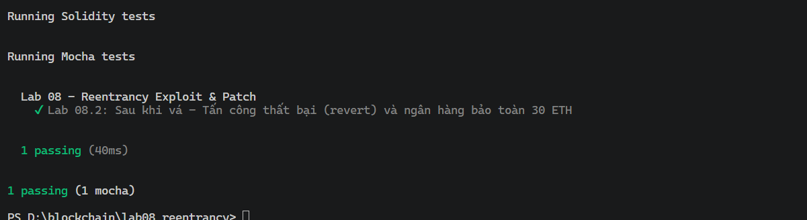

# Báo cáo thực hành Lab 08 – Reentrancy: Exploit then Patch (EtherBank)

- **Họ và tên:** Nguyễn Hữu Luân
- **Mục tiêu:** Khai thác rút cạn ngân hàng dính lỗi và vá lại theo chuẩn CEI + nonReentrant.

---

### 1. Kết quả kiểm thử Unit Tests
- Bản dễ tổn thương (Lab 08.1): Tấn công thành công, rút cạn 30 ETH về 0.
- Bản đã vá (Lab 08.2): Tấn công bị revert, ngân hàng giữ nguyên vẹn 30 ETH.
- Trạng thái: All tests passed (Xanh).

---

### 2. Tóm tắt nguyên nhân lỗi và dòng mã sửa đổi (One Paragraph)
Lỗ hổng bảo mật nằm ở thứ tự thực thi trong hàm `withdraw()`: hợp đồng thực hiện gửi tiền ra ngoài `msg.sender.call{value: bal}("")` trước khi cập nhật số dư về 0 `balances[msg.sender] = 0;`. Điều này cho phép hợp đồng nhận tiền nắm quyền thực thi và gọi lại `withdraw()` liên tục khi số dư on-chain vẫn còn nguyên. 
Cách sửa: Áp dụng mô hình Checks-Effects-Interactions (CEI) bằng cách di chuyển dòng trừ số dư `balances[msg.sender] = 0;` lên trước lệnh gọi chuyển tiền `.call`, đồng thời kế thừa `ReentrancyGuard` của OpenZeppelin và thêm modifier `nonReentrant` vào hàm `withdraw()`.

---

Q0: Thứ tự thực thi của withdraw() là gì? Vì sao thứ tự đó là toàn bộ vấn đề?
  Thứ tự là: (a) Gửi ETH trước qua `.call`, sau đó mới (b) cập nhật `balances[msg.sender] = 0`. Thứ tự này chuyển quyền kiểm soát luồng thực thi cho hàm nhận tiền của bên ngoài trước khi số dư nội bộ bị xóa, tạo điều kiện cho bên ngoài tái nhập (re-enter) nhiều lần.

Q1: withdraw() chạy bao nhiêu lần trong 1 giao dịch attack()? Điều gì dừng vòng lặp?
  Hàm `withdraw()` chạy tổng cộng 31 lần (1 lần gọi ban đầu + 30 lần đệ quy tái nhập). Vòng lặp dừng lại khi số dư của ngân hàng nhỏ hơn 1 ETH (`address(bank).balance < UNIT`), làm điều kiện `if` trong `receive()` của Attacker trả về false.

Q2: Nếu dùng transfer() thay vì call, tấn công có chạy được không? Vì sao transfer() không phải cách vá thật?
  Tấn công này sẽ bị chặn vì `transfer()` chỉ cung cấp tối đa 2300 gas stipend, không đủ gas để thực hiện tiếp lệnh gọi ngoài `withdraw()`. Tuy nhiên, `transfer()` không phải cách vá thật vì chi phí gas có thể thay đổi sau các đợt nâng cấp mạng (như EIP-1884), và nó sẽ khiến các ví hợp đồng thông minh (multisig, smart account) không thể nhận tiền hợp lệ.

Q3: Chỉ CEI đã đủ chặn lỗi, vì sao vẫn nên thêm nonReentrant guard?
  CEI bảo vệ chống lại việc tái nhập vào chính hàm đó (single-function reentrancy). Modifier `nonReentrant` bảo vệ chống lại tấn công Reentrancy chéo hàm (cross-function reentrancy) hoặc chéo hợp đồng, nơi kẻ tấn công tái nhập vào một hàm khác đọc cùng biến trạng thái chưa được đồng bộ.

Q4: Vì sao thông báo revert là "transfer failed" chứ không phải thông báo của guard?
  Lệnh gọi cấp thấp `.call{value: ...}("")` không tự động truyền tiếp chuỗi lỗi (revert reason) khi giao dịch con bị revert mà chỉ trả về cờ boolean `ok = false`. Do đó, hợp đồng bên ngoài nhận `ok == false` và ném ra thông báo do lệnh require của nó quy định: `require(ok, "transfer failed")`.

Q5: Slither cảnh báo low-level-calls ở bản an toàn, đó có phải lỗ hổng không?
  Không phải lỗ hổng. `.call{value: ...}("")` là chuẩn được khuyến nghị hiện nay để gửi ETH. Slither chỉ gắn cờ ở mức Thông tin (Informational) để nhắc nhở lập trình viên phải luôn kiểm tra giá trị trả về `(bool ok, )` vì lệnh gọi cấp thấp không kiểm tra mã bytecode tại địa chỉ đích.

Q6: Nếu dùng tx.origin == owner, kẻ tấn công lừa owner đánh cắp quyền như thế nào?
  Kẻ tấn công tạo một hợp đồng độc hại lừa `owner` gửi giao dịch tương tác vào đó. Hợp đồng này ngay lập tức gọi tiếp sang hàm `setOwner(attacker)`. Khi đó, `msg.sender` là hợp đồng bẫy nhưng `tx.origin` vẫn là địa chỉ ví gốc của `owner`, giúp kẻ tấn công vượt qua điều kiện kiểm tra và chiếm quyền sở hữu.