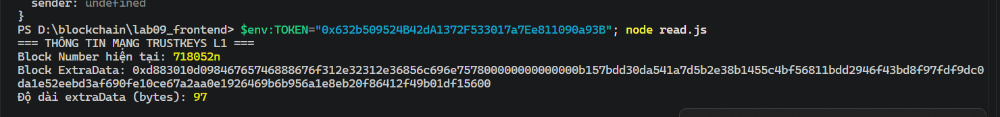
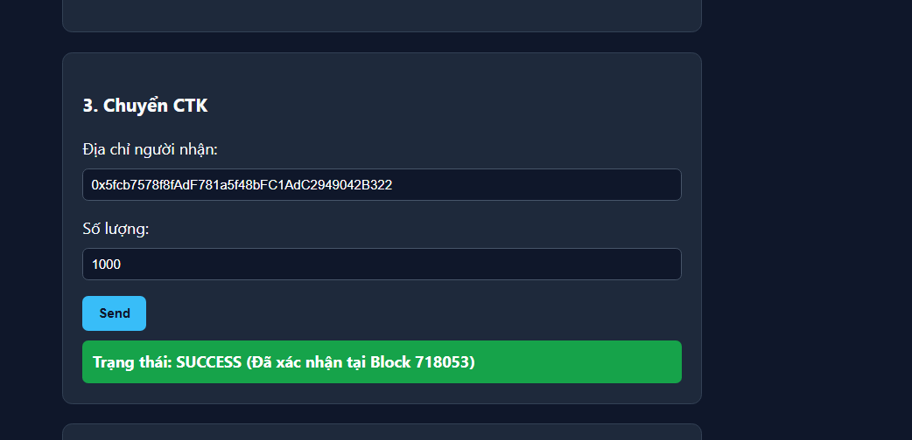
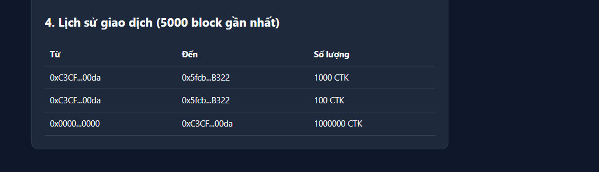

# Báo cáo thực hành Lab 09 – Frontend DApp với viem (TrustKeys L1)

- **Họ và tên:** Nguyễn Hữu Luân
- **Mạng thực hành:** TrustKeys L1 Testnet (Chain ID: 11968)[cite: 10]
- **Địa chỉ ClassToken (Session 7):** `0x_dia_chi_contract_token_cua_ban`[cite: 10]
- **Địa chỉ ví thử nghiệm:** `0xC3CF9f66dB715769Fe0C902d136c66cDeE3000da`

---

### 1. Kết quả chạy script Node không cần ví (Lab 9.1 - read.js)
- Thao tác: Chạy `node read.js` với biến môi trường `$env:TOKEN="0x..."`[cite: 11].
- Kết quả trích xuất:
  - Block Number hiện tại: `718052n`
  - Block ExtraData: `0xd883010d09846765746888676f312e32312e36856c696e757800000000000000b157bdd30da541a7d5b2e38b1455c4bf56811bdd2946f43bd8f97fdf9dc0da1e52eebd3af690fe10ce67a2aa0e1926469b6b956a1e8eb20f86412f49b01df15600`
  - Độ dài `extraData`: **97 bytes** (xác nhận cơ chế PoA/Clique)[cite: 11, 14].
  - Metadata Token: Name = `ClassToken`, Symbol = `CTK`, Decimals = `18`[cite: 11].

---

### 2. Giao diện DApp & Thao tác chuyển token (Lab 9.2 & 9.3)
- Kết nối ví MetaMask thông qua `custom(window.ethereum)` / EIP-1193[cite: 11].
- Tải token qua `publicClient.readContract` và hiển thị số dư thành công[cite: 11].
- Thực hiện giao dịch chuyển CTK qua quy trình chuẩn:
  1. `simulateContract`: Giả lập kiểm tra lỗi trước khi ký (không tốn gas)[cite: 12, 14].
  2. `writeContract`: Người dùng ký giao dịch trên ví $\rightarrow$ trạng thái **PENDING**[cite: 12].
  3. `waitForTransactionReceipt`: Chờ xác nhận on-chain $\rightarrow$ trạng thái **SUCCESS**[cite: 12].

 

---

### 3. Lịch sử sự kiện (Lab 9.4 - getLogs)
- Truy vấn sự kiện `Transfer` trong phạm vi 5000 block gần nhất bằng `publicClient.getContractEvents`[cite: 12].
- Giao dịch vừa thực hiện hiển thị ngay trong danh sách lịch sử on-chain[cite: 10, 12].

> *Ảnh chụp bảng lịch sử giao dịch trên giao diện:*

---

### 4. Trả lời câu hỏi lý thuyết (Q1 – Q7)

- **Q1: Ở web2, "đọc số dư" gọi database máy chủ. Ở đây, đọc số dư gọi tới đâu, và vì sao miễn phí?**
  Đọc số dư gọi trực tiếp tới node RPC của TrustKeys thông qua phương thức `eth_call`[cite: 14]. Thao tác này chỉ truy vấn trạng thái công khai hiện tại của blockchain mà không làm thay đổi trạng thái lưu trữ (state), không tạo block giao dịch mới nên các node RPC phục vụ hoàn toàn miễn phí không tốn gas[cite: 14].

- **Q2: Vì sao con số extraData 97 bytes quan trọng trên TrustKeys, và vì sao viem đọc được block trong khi web3.py thô sẽ lỗi?**
  `extraData` có độ dài lớn hơn 32 bytes (cụ thể là 97 bytes) là dấu hiệu cho thấy TrustKeys là chuỗi Proof-of-Authority (PoA / Clique), trong đó 65 bytes cuối cùng chứa chữ ký của validator[cite: 14]. Thư viện `viem`, `ethers` và MetaMask đã tích hợp sẵn cơ chế phân tích cấu trúc khối PoA; trong khi thư viện `web3.py` nguyên bản chỉ mặc định hỗ trợ chuẩn PoW (tối đa 32 bytes) nên sẽ quăng ngoại lệ nếu không cài thêm middleware `ExtraDataToPOAMiddleware`[cite: 14].

- **Q3: Khác biệt giữa provider và signer (public client vs wallet client)?**
  Provider (`public client`) chỉ đọc dữ liệu trạng thái công khai qua RPC và không quản lý khóa riêng tư[cite: 10, 14]. Signer (`wallet client`) nắm giữ hoặc kết nối trực tiếp với khóa riêng tư để ký dữ liệu và phát các giao dịch ghi (`write`) làm thay đổi trạng thái blockchain[cite: 10, 14]. Mọi thao tác đọc đều không cần signer[cite: 14].

- **Q4: Vì sao chúng ta gọi simulateContract trước writeContract? Vì sao không cập nhật số dư trước khi có receipt?**
  Hàm `simulateContract` thực hiện cuộc gọi giả lập cục bộ trên node RPC để bắt sớm các lỗi revert (nếu có) trước khi người dùng ký, tránh việc gửi giao dịch lỗi lên chuỗi làm mất phí gas vô ích[cite: 12, 14, 15]. Không cập nhật số dư sớm vì giao dịch ở trạng thái pending có thể bị từ chối, bị revert hoặc mạng gặp tình trạng tổ chức lại khối (re-org); chỉ `receipt` sau khi block được đóng mới là cơ sở chính xác khẳng định giao dịch đã thành công[cite: 12, 15].

- **Q5: Cửa sổ getLogs là 5000 block; nếu hỏi từ block 0 trên chain đông sẽ hỏng gì, và cách khắc phục thật là gì?**
  Truy vấn toàn bộ lịch sử từ block 0 trên một mạng lưới lớn với hàng triệu block sẽ làm node RPC bị quá tải, dẫn đến lỗi timeout hoặc bị ngắt kết nối do giới hạn tải (rate-limit)[cite: 12, 15]. Cách xử lý thực tế trong môi trường production là phân trang theo cửa sổ block cố định, hoặc sử dụng các giải pháp indexer chuyên dụng (như The Graph, Ponder) để lập chỉ mục dữ liệu vào database và truy vấn qua GraphQL[cite: 12, 15].

- **Q6: Ảnh huy hiệu về dưới dạng data-URI (data:image/svg+xml;base64,...), trình duyệt hiển thị thế nào khi không có gateway IPFS và máy chủ ảnh?**
  Chuỗi data-URI là định dạng tự chứa nội dung (self-describing)[cite: 15]. Bộ render của trình duyệt tự động giải mã các byte base64 thành mã nguồn vector SVG nội tại và vẽ trực tiếp lên màn hình mà không cần thực hiện bất kỳ lệnh gọi mạng (HTTP request) nào ra bên ngoài[cite: 15].

- **Q7: wagmi thêm gì so với gọi viem thủ công, và dùng lại nguyên vẹn cái gì?**
  `wagmi` bổ sung hệ thống React Hooks, lớp quản lý trạng thái, tầng trừu tượng hóa ví (connectors) và tích hợp sẵn bộ nhớ đệm TanStack Query (hỗ trợ tự động refetch, loại bỏ request trùng lặp, cờ quản lý loading/error)[cite: 13, 14, 15]. Nó tái sử dụng nguyên vẹn các viem client, đối tượng cấu hình chuỗi (`defineChain`) và định dạng ABI[cite: 14, 15].